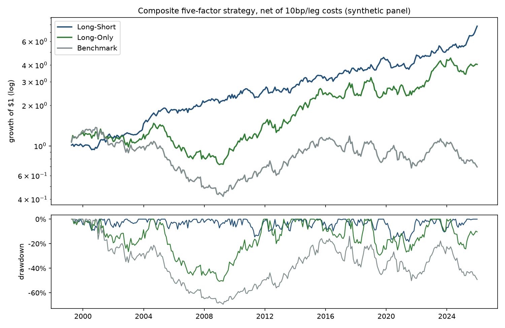
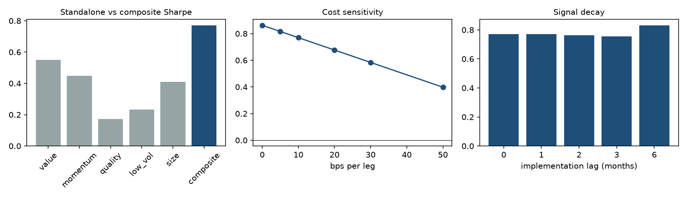
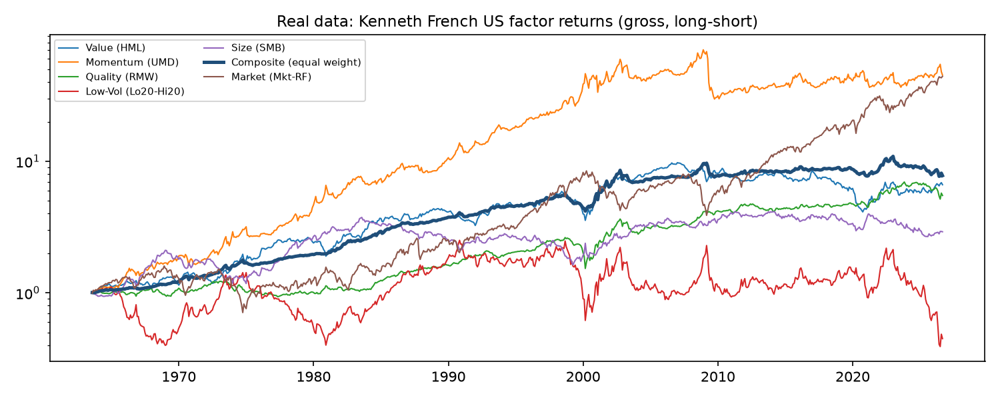

# Systematic Equity Factor Strategy

A cross-sectional equity strategy in Python that combines five factors: **Value, Momentum, Quality, Low-Vol and
Size**.

```
raw signals → winsorise (1st/99th pct) → cross-sectional z-scores → equal-weighted composite
            → quantile sort at month end → hold next month → long-short (dollar-neutral) and long-only
            → costs: 10bp per leg × one-way turnover
```

It ships with a seven-test robustness suite, an Excel workbook, charts, and a **real-data check** against Kenneth
French's published US factor returns.

> **Read this first: the headline backtest runs on a synthetic panel.** The simulated market has factor premia
> built in, so the backtest shows that the pipeline *recovers* those premia through noisy signals and trading
> costs. It does **not** show that the factors earn money in real markets. For that, see the
> [real-data check](#real-data-check-kenneth-french-us-factors) below, which tells a more sober story.



## Headline results (synthetic panel, net of 10bp/leg costs)

1,000 stocks, 323 months, quintile sorts, monthly rebalancing. The dates are labels for the simulated months and
have no connection to real market history.

| | Ann. return | Ann. vol | Sharpe | Max DD | NW t-stat | Monthly turnover |
|---|---:|---:|---:|---:|---:|---:|
| **Long-Short** | **8.0%** | 10.7% | **0.77** | −18.4% | **4.23** | 0.83 |
| Long-Only | 5.3% | 16.1% | 0.40 | −50.7% | 2.01 | 0.42 |
| Benchmark (cap-weighted) | −1.3% | 16.7% | 0.00 | −69.4% | 0.02 | – |

- **Weak benchmark.** The simulated market path happened to be weak: it realised 0.24% a month against a
  0.6% drift. The seed was fixed before any results were seen and was not changed afterwards.
- **Size drag.** The cap-weighted benchmark also gives up the size premium built into the simulation.

### Robustness suite ([`robustness.py`](robustness.py))

| Test | Result |
|---|---|
| 1. Sub-periods | Sharpe positive in all four splits: **0.98, 0.57, 0.48, 1.06** |
| 2. Parameter sensitivity | Long-short Sharpe 0.82 / 0.77 / 0.77 at 3 / 5 / 10 quantiles; long-only 0.39 / 0.40 / 0.48 |
| 3. Cost sensitivity | Sharpe 0.86 at 0bp, 0.77 at 10bp, **0.40 at 50bp**; break-even at 93bp per leg |
| 4. Block bootstrap | 2,000 resamples (12-month blocks): **P(Sharpe > 0) = 1.00**, 5–95% band **[0.51, 1.04]** |
| 5. Factor decomposition | Momentum (34% of return), size (21%) and value (20%) drive it; quality and low-vol add little. The **composite beats every standalone factor** (0.77 vs a best single factor of 0.55). |
| 6. Signal decay | Sharpe 0.77 / 0.77 / 0.76 / 0.75 at 0 / 1 / 2 / 3 months of implementation lag; 0.83 at 6 months |
| 7. Deflated Sharpe | 25 configurations tried; the expected best of 25 unskilled trials is 0.40. **DSR = 0.970, which passes at 95%.** |

The decay test is flat because the simulated characteristics are slow-moving by design: the AR(1) persistence of
value, quality and size is 0.98 to 0.995. In real data, momentum decays much faster.



## Real-data check: Kenneth French US factors

The same five-factor idea applied to **published, real US long-short factor returns** (gross of costs). The
composite is an equal-weighted mix of value (HML), momentum (UMD), quality (RMW), low-vol (lowest minus highest
variance quintile) and size (SMB).

| Composite of real factors | Ann. return | Sharpe | Max DD | NW t |
|---|---:|---:|---:|---:|
| 1963–2026 | 3.3% | **0.52** | −29.6% | 3.69 |
| Since 2000 | 2.2% | **0.28** | −29.6% | 1.31 |
| Last quarter of the sample (Dec 2010 – Aug 2026) | 0.0% | **0.03** | −29.6% | – |

| Real factor, 1963–2026 | Sharpe | Since 2000 |
|---|---:|---:|
| Value (HML) | 0.34 | 0.22 |
| Momentum (UMD) | 0.49 | 0.13 |
| Quality (RMW) | 0.38 | 0.42 |
| Low-Vol (unhedged Lo20 − Hi20) | 0.06 | 0.05 |
| Size (SMB) | 0.21 | 0.20 |



**What this says:**
- **Diversification works.** Combining the factors roughly halves volatility, so the composite's Sharpe (0.52)
  beats every single factor over the full history.
- **The premia have shrunk.** Since 2000 the composite is not statistically significant, and over the last 16
  years it has earned nothing before costs. Only quality has held up.
- **Low-vol needs beta hedging.** As a raw dollar-neutral spread it carries a large negative market beta and
  barely breaks even. Practitioners hedge that beta out (betting-against-beta), which this check does not.

## How the results compare with the original project notes

| Note | This build | Why |
|---|---|---|
| Long-Short 8.3% / Sharpe 1.29 / MaxDD −9.4% / t 5.38 | 8.0% / **0.77** / −18.4% / 4.23 | Different synthetic calibration: each factor here is calibrated to realistic premia **and** realistic factor volatility, giving standalone Sharpe ratios of about 0.2–0.55. |
| Long-Only 13.3% / 0.87; Benchmark 9.0% / 0.63 | 5.3% / 0.40; −1.3% / 0.00 | The simulated market path in this build was weak (see above). |
| Sub-period Sharpes 0.95–1.57 | 0.48–1.06, all positive | Same conclusion, lower level. |
| Holds across 3/5/10 quantiles and both constructions | Yes | |
| Sharpe 0.68 at 50bp | 0.40 at 50bp | Lower starting Sharpe; break-even at 93bp. |
| Bootstrap P(SR>0) = 1.00, band [0.91, 1.72] | 1.00, band [0.51, 1.04] | |
| Momentum and value drive it; composite beats every factor | Momentum, size and value drive it; composite beats every factor | |
| Survives a 1–3 month lag | Yes (Sharpe 0.75–0.77) | |
| Passes the deflated Sharpe for ~18 configs | Passes for 25 configs (DSR 0.970) | |

The numbers in your notes came from a different synthetic panel, so the two sets can't be compared directly: both
measure the generator's assumptions, not the market. I didn't tune this build's generator toward them. **On real
data, the composite's Sharpe is about 0.5 over 60 years and about 0.3 since 2000.**

## Methodology

### Signals (end of month *t*)

| Factor | Raw signal | Direction |
|---|---|---|
| Value | log book-to-market | high is better |
| Momentum | cumulative return from *t*−11 to *t*−1 (12-1, skipping the latest month) | high is better |
| Quality | return on equity | high is better |
| Low-Vol | trailing 12-month volatility of monthly returns | low is better |
| Size | log market cap | small is better |

- **Standardising:** each month, every signal is winsorised at the 1st/99th percentile and z-scored across stocks.
- **Composite:** the equal-weighted average of the available z-scores. A stock needs at least 60% factor
  coverage to be scored.

### Portfolios and costs
- **Holding period:** portfolios formed on the score at the end of month *t* are held through month *t*+1.
- **Long-short:** equal-weighted top quantile minus bottom quantile, $1 long and $1 short.
- **Long-only:** equal-weighted top quantile.
- **Costs:** turnover is measured against weights that have drifted with returns, so it only counts trading needed
  to get back to target. Costs are 10bp × one-way turnover, charged on each leg.
- **Benchmark:** the cap-weighted universe.

### Metrics
- annualised geometric return, volatility, Sharpe and Sortino
- maximum drawdown
- **Newey-West t-statistic** of the mean monthly return (6 lags)
- hit rate, skew, kurtosis and turnover

### The synthetic panel ([`make_synthetic_panel`](factor_engine.py))
- **Universe:** 1,000 stocks with slowly moving true characteristics (value, quality, smallness, idiosyncratic
  volatility).
- **Return process:** next month's return loads on those characteristics and on the stock's own 12-1 return
  (momentum as continuation). Premia are time-varying:
  r = β·MKT + Σ x·(λ + s·η) + σ·ε
- **Calibration:** long-short premia of about value 4%, momentum 7%, quality 3.4%, low-vol 3.4% and size 1.7% a
  year, with factor volatilities of about 10%, 15%, 7%, 12% and 10%. These are in line with long-run US
  estimates.
- **What the engine sees:** noisy proxies (book-to-market, ROE, market cap with measurement error), with momentum
  and volatility computed from simulated returns. The signals predict returns, but imperfectly.

### Robustness tests

| # | Test | Method |
|---|---|---|
| 1 | Sub-periods | four equal non-overlapping splits |
| 2 | Parameters | 3/5/10 quantiles × long-short/long-only |
| 3 | Costs | 0–50bp per leg on the same trades; break-even cost |
| 4 | Bootstrap | circular block bootstrap, 12-month blocks, 2,000 resamples |
| 5 | Decomposition | standalone factor portfolios, leave-one-out composites, regression attribution |
| 6 | Signal decay | 0/1/2/3/6-month implementation lag |
| 7 | Deflated Sharpe | Bailey & López de Prado (2014), with every distinct configuration run counted as a trial |

## Using real data

`load_data()` returns a long panel with columns `date, ticker, ret, mktcap, book_to_market, roe`. Any loader that
returns this schema plugs straight in.

```python
import factor_engine as fe
panel = fe.load_data("yfinance", tickers=["AAPL", "MSFT", ...], start="2005-01-01")
res = fe.run_strategy(panel, n_q=5)
```

The built-in yfinance loader has limits:
- **Missing factors.** It provides prices only, so it computes **Momentum and Low-Vol** and leaves value, quality
  and size empty. yfinance has no point-in-time book equity, ROE or share counts.
- **Survivorship bias.** Today's index members bias any backtest.
- **What a proper test needs:** point-in-time fundamentals and a survivorship-free universe, for example
  CRSP/Compustat.

## Run it

```bash
git clone https://github.com/spruha17nimkar/Systematic-Equity-Factor-Strategy-.git
cd Systematic-Equity-Factor-Strategy-
python -m venv .venv && source .venv/bin/activate
pip install -r requirements.txt

python run_analysis.py              # synthetic backtest + robustness + French check → output/
python run_analysis.py --no-french  # offline
pytest                              # 13 tests
```

Outputs:
- **`output/REPORT.md`:** every table
- **`output/factor_strategy_results.xlsx`:** summary, monthly returns, one sheet per robustness test, real-data
  check
- **`output/figures/`:** charts
- **`output/summary.json`:** machine-readable results

## Files

| File | Contents |
|---|---|
| [`factor_engine.py`](factor_engine.py) | data (synthetic, yfinance, French), signals, winsorise/z-score, composite, quantile portfolios, backtest with costs, metrics |
| [`robustness.py`](robustness.py) | the seven-test suite |
| [`run_analysis.py`](run_analysis.py) | runner: charts, Excel, Markdown report, JSON |
| [`tests/test_engine.py`](tests/test_engine.py) | unit tests (signal timing, weights, costs, metrics, bootstrap, deflated Sharpe) |

## License
MIT
