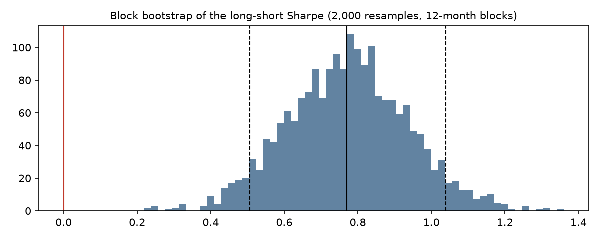

# Results

Synthetic panel: 1,000 stocks, 323 months (1999-02 to 2025-12). Quintile sorts, monthly rebalancing, 10bp per leg.

## Headline (net of costs)

| index | ann_return | ann_vol | sharpe | max_drawdown | nw_t_stat | avg_monthly_turnover |
|---|---|---|---|---|---|---|
| Long-Short | 8.0% | 10.7% | 0.77 | -18.4% | 4.23 | 0.83 |
| Long-Only | 5.3% | 16.1% | 0.40 | -50.7% | 2.01 | 0.42 |
| Benchmark | -1.3% | 16.7% | 0.00 | -69.4% | 0.02 | – |

## 1. Sub-periods

| period | months | ann_return | sharpe | max_drawdown |
|---|---:|---:|---:|---:|
| 1999-03 to 2005-11 | 81 | 9.5% | 0.98 | -9.3% |
| 2005-12 to 2012-08 | 81 | 6.0% | 0.57 | -14.4% |
| 2012-09 to 2019-04 | 80 | 4.5% | 0.48 | -9.7% |
| 2019-05 to 2025-12 | 80 | 11.9% | 1.06 | -18.4% |

## 2. Parameter sensitivity

| construction | quantiles | ann_return | ann_vol | sharpe | max_drawdown | nw_t_stat | avg_monthly_turnover |
|---|---:|---:|---:|---:|---:|---:|---:|
| long_short | 3 | 6.6% | 8.2% | 0.82 | -14.0% | 4.47 | 0.68 |
| long_short | 5 | 8.0% | 10.7% | 0.77 | -18.4% | 4.23 | 0.83 |
| long_short | 10 | 10.2% | 14.0% | 0.77 | -21.3% | 4.16 | 1.00 |
| long_only | 3 | 5.1% | 15.6% | 0.39 | -51.9% | 1.92 | 0.33 |
| long_only | 5 | 5.3% | 16.1% | 0.40 | -50.7% | 2.01 | 0.42 |
| long_only | 10 | 6.8% | 16.4% | 0.48 | -47.3% | 2.41 | 0.52 |

## 3. Cost sensitivity (long-short)

| cost_bps_per_leg | ann_return | sharpe | nw_t_stat |
|---:|---:|---:|---:|
| 0.000 | 9.0% | 0.86 | 4.75 |
| 5.000 | 8.5% | 0.82 | 4.49 |
| 10.000 | 8.0% | 0.77 | 4.23 |
| 20.000 | 6.9% | 0.68 | 3.72 |
| 30.000 | 5.8% | 0.58 | 3.21 |
| 50.000 | 3.8% | 0.40 | 2.18 |

Break-even cost: 93bp per leg.

## 4. Block bootstrap

2,000 circular block resamples (12-month blocks): P(Sharpe > 0) = 1.000; 5th-95th percentile [0.51, 1.04]; median 0.77.

## 5. Factor decomposition

| portfolio | ann_return | sharpe | nw_t_stat | avg_monthly_turnover |
|---|---:|---:|---:|---:|
| value | 3.9% | 0.55 | 2.96 | 0.89 |
| momentum | 5.8% | 0.45 | 2.47 | 1.02 |
| quality | 0.9% | 0.17 | 0.90 | 0.86 |
| low_vol | 1.7% | 0.23 | 1.32 | 0.69 |
| size | 3.5% | 0.41 | 2.18 | 0.62 |
| composite | 8.0% | 0.77 | 4.23 | 0.83 |

Composite beats every standalone factor: yes.

Leave-one-out:

| dropped | sharpe | sharpe_change |
|---|---:|---:|
| value | 0.69 | -0.08 |
| momentum | 0.69 | -0.08 |
| quality | 0.79 | +0.02 |
| low_vol | 0.81 | +0.04 |
| size | 0.63 | -0.14 |

Return attribution (composite regressed on the standalone factor portfolios, R² 0.96):

| factor | beta | contribution_ann | share_of_return |
|---|---:|---:|---:|
| value | 0.40 | 1.7% | 20.0% |
| momentum | 0.43 | 2.9% | 34.2% |
| quality | 0.39 | 0.2% | 2.9% |
| low_vol | 0.38 | 0.8% | 9.1% |
| size | 0.41 | 1.8% | 21.1% |
| alpha (diversification / interaction) | – | 1.1% | 12.7% |

## 6. Signal decay

| lag_months | ann_return | sharpe | nw_t_stat |
|---:|---:|---:|---:|
| 0.000 | 8.0% | 0.77 | 4.23 |
| 1.000 | 7.6% | 0.77 | 4.33 |
| 2.000 | 7.4% | 0.76 | 4.12 |
| 3.000 | 7.0% | 0.75 | 4.11 |
| 6.000 | 6.9% | 0.83 | 4.58 |

## 7. Deflated Sharpe ratio

25 distinct configurations evaluated. Expected maximum Sharpe from that many unskilled trials: 0.40. Observed 0.77. Deflated Sharpe probability 0.970 → passes at 95%.

## Real-data check: Kenneth French US factors (gross of costs)

| index | ann_return | ann_vol | sharpe | max_drawdown | nw_t_stat | start | end |
|---|---|---|---|---|---|---|---|
| Value (HML) | 3.0% | 10.3% | 0.34 | -57.8% | 2.29 | 1963-07-31 | 2026-08-31 |
| Momentum (UMD) | 6.2% | 14.6% | 0.49 | -57.8% | 3.87 | 1963-07-31 | 2026-08-31 |
| Quality (RMW) | 2.7% | 7.9% | 0.38 | -41.8% | 2.79 | 1963-07-31 | 2026-08-31 |
| Low-Vol (Lo20-Hi20) | -1.3% | 23.0% | 0.06 | -84.4% | 0.47 | 1963-07-31 | 2026-08-31 |
| Size (SMB) | 1.7% | 10.5% | 0.21 | -56.4% | 1.60 | 1963-07-31 | 2026-08-31 |
| Composite (equal weight) | 3.3% | 6.7% | 0.52 | -29.6% | 3.69 | 1963-07-31 | 2026-08-31 |
| Market (Mkt-RF) | 6.2% | 15.4% | 0.47 | -55.8% | 3.63 | 1963-07-31 | 2026-08-31 |

Since 2000:

| index | ann_return | ann_vol | sharpe | max_drawdown | nw_t_stat | start | end |
|---|---|---|---|---|---|---|---|
| Value (HML) | 1.9% | 11.9% | 0.22 | -57.8% | 0.96 | 2000-01-31 | 2026-08-31 |
| Momentum (UMD) | 0.6% | 17.6% | 0.13 | -57.8% | 0.68 | 2000-01-31 | 2026-08-31 |
| Quality (RMW) | 3.8% | 10.3% | 0.42 | -25.9% | 2.19 | 2000-01-31 | 2026-08-31 |
| Low-Vol (Lo20-Hi20) | -2.6% | 28.1% | 0.05 | -82.9% | 0.26 | 2000-01-31 | 2026-08-31 |
| Size (SMB) | 1.6% | 10.7% | 0.20 | -35.3% | 1.13 | 2000-01-31 | 2026-08-31 |
| Composite (equal weight) | 2.2% | 9.0% | 0.28 | -29.6% | 1.31 | 2000-01-31 | 2026-08-31 |
| Market (Mkt-RF) | 6.5% | 15.7% | 0.48 | -54.1% | 2.41 | 2000-01-31 | 2026-08-31 |

Composite sub-periods:

| period | months | ann_return | sharpe | max_drawdown |
|---|---:|---:|---:|---:|
| 1963-07 to 1979-04 | 190 | 4.2% | 1.10 | -9.2% |
| 1979-05 to 1995-02 | 190 | 5.7% | 1.44 | -6.9% |
| 1995-03 to 2010-11 | 189 | 3.4% | 0.39 | -26.4% |
| 2010-12 to 2026-08 | 189 | -0.0% | 0.03 | -29.6% |

